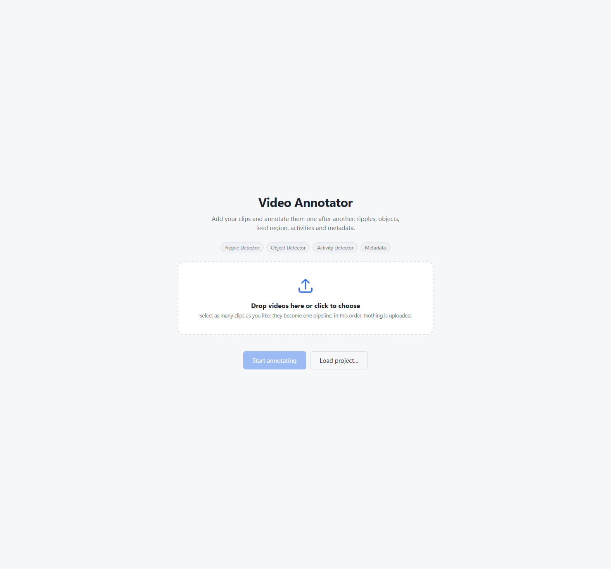
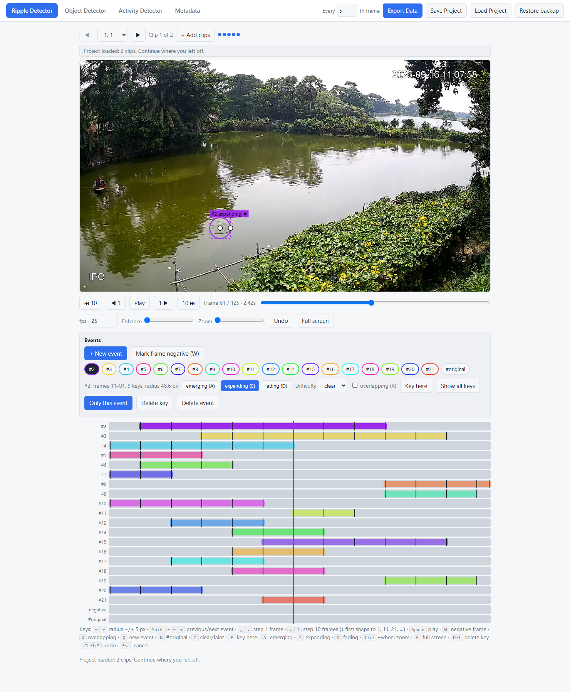
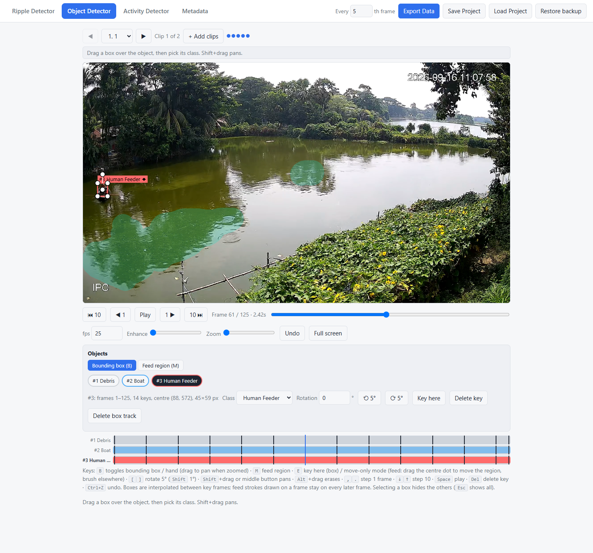
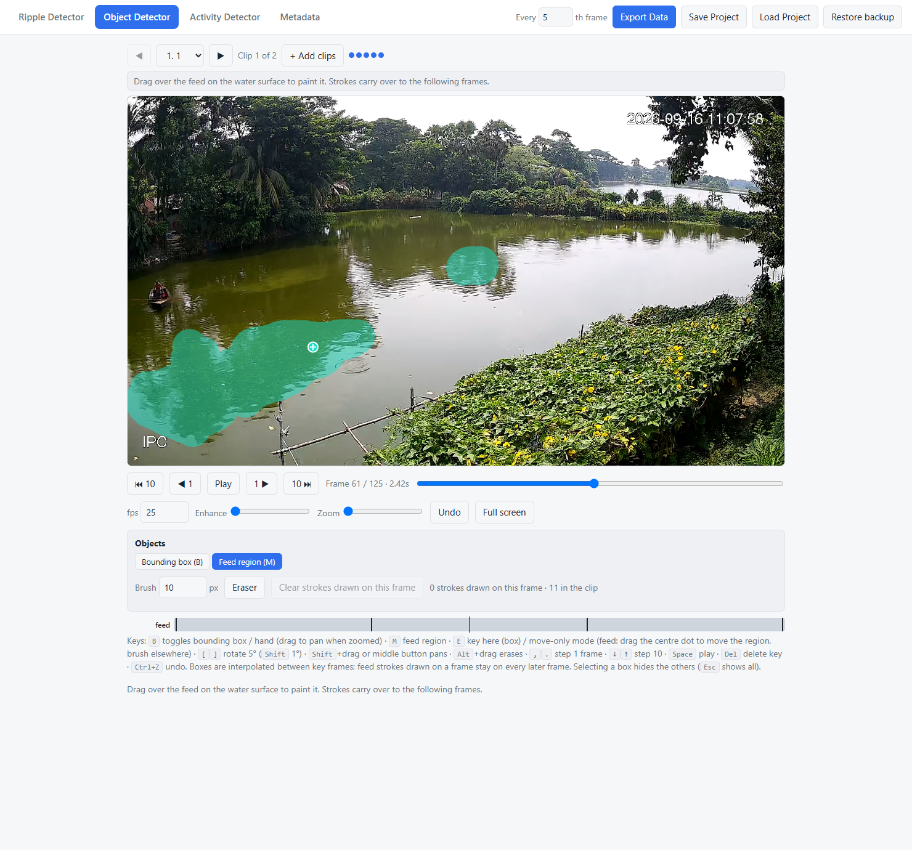
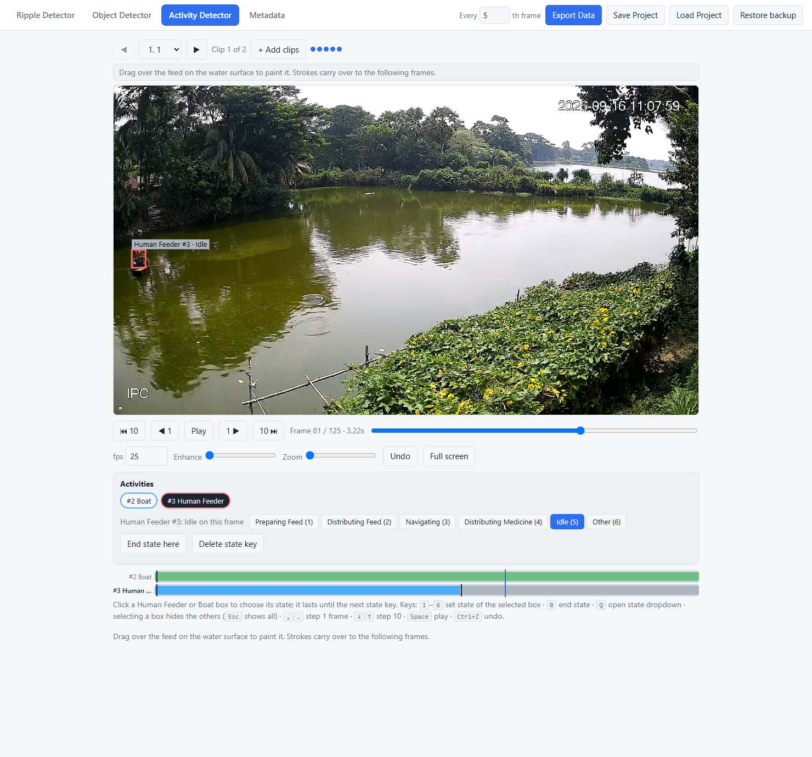
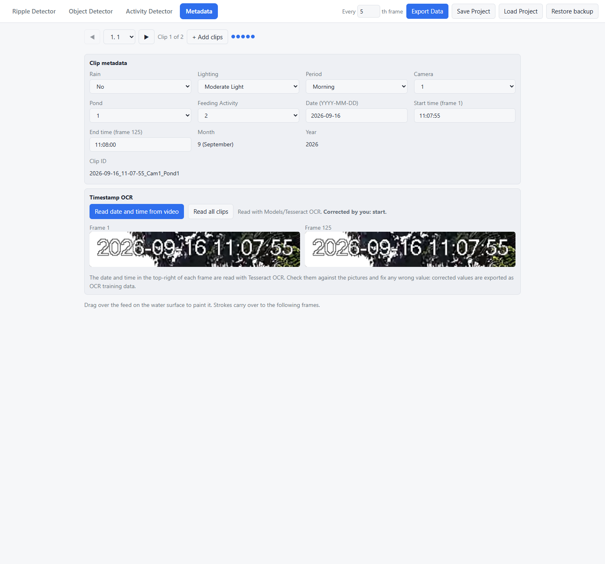

# Annotator User Guide

Reference for every control, shortcut and output of `Annotator/Annotator.html`. Screenshots and examples use the clip `2026-09-16_11-07-55_Cam1_Pond1` from the showcase project.

**Contents**
1. [Start, clips and the workspace](#1-start-clips-and-the-workspace)
2. [Playback and view controls](#2-playback-and-view-controls)
3. [Ripple Detector](#3-ripple-detector)
4. [Object Detector](#4-object-detector)
5. [Activity Detector](#5-activity-detector)
6. [Metadata](#6-metadata)
7. [Saving, loading and backups](#7-saving-loading-and-backups)
8. [Export](#8-export)
9. [Shortcut reference](#9-shortcut-reference)
10. [Troubleshooting](#10-troubleshooting)

---

## 1. Start, clips and the workspace



**Start page.** Either drop videos (or click the drop area) and press **Start annotating**, or press **Load project...** to reopen saved work. Clips become one pipeline in the order added. Nothing is uploaded.

**Top bar.**

| Control | Function |
|---|---|
| Ripple / Object / Activity / Metadata | Switch tab. The video and your position are kept. |
| **Every [N] th frame** | Export density. Default **5**: every key frame plus every 5th frame in between (see [Export](#8-export)). |
| **Export Data** | Build the dataset zip for all clips. |
| **Save Project** / **Load Project** / **Restore backup** | See [Saving](#7-saving-loading-and-backups). |

**Clip bar.** `◀ ▶` or the dropdown change clip; **+ Add clips** appends more videos; the five dots show which tabs already hold annotations on this clip (ripple, object, feed, activity, metadata).

**Workspace.** Video with the drawing layer on top, transport row, view row, the tab's panel, and a timeline. A status line at the bottom reports what the last action did.

---

## 2. Playback and view controls

| Control | Key | Function |
|---|---|---|
| `⏮ 10` / `10 ⏭` | `↓` / `↑` | Back / forward 10 frames. `↓` first snaps to frame 1, 11, 21, ... |
| `◀ 1` / `1 ▶` | `,` / `.` | Back / forward one frame |
| Play | `Space` | Play or pause (annotating pauses playback) |
| Seek slider | | Jump to any frame; the label shows `Frame n / total · seconds` |
| fps | | Frame rate used to map time to frame numbers (read from the file; change only if wrong, annotations refer to it) |
| Enhance | | Raises contrast and colour saturation to help see faint ripples; display only, exports are unchanged |
| Zoom | `Ctrl`+wheel | 1x to 6x. When zoomed, drag the background to pan (middle button, or `Shift`+drag in Object/Activity, also pans) |
| Undo | `Ctrl+Z` | Undo the last edit in the tab |
| Full screen | `F` | Video fills the screen with the overlays |
| | `Esc` | Cancel the current mode, deselect, show all annotations |

Annotations are stored per frame number, so scrub freely; nothing is written until you save.

---

## 3. Ripple Detector

A **ripple event** is one ripple followed through time: a fixed centre, and a radius that is set on a few **key frames** and interpolated in between. Every event also has a **stage** (emerging, expanding, fading), a **difficulty** (clear / faint) and an **overlapping** flag.



*Event #2 selected at frame 61: its ring and handles on the video, the event chips, the stage buttons, and the timeline where each coloured bar spans an event and each black tick is a key frame.*

### Procedure

1. **Find a ripple.** Step to the frame where it first appears (`,` `.`, `↑` `↓`). Zoom in (`Ctrl`+wheel) if it is small.
2. **Create the event.** Press `Q` (or **+ New event**), click the ring's centre, and drag out to its outer edge. The event starts at this frame with stage *emerging*.
3. **Follow it.** Step ahead a few frames (every 10th is usually enough). Drag the ring's edge handle to the new radius; a key frame is created. Drag the centre dot to move the ring if the ripple drifted. Press `E` to add a key without changing the size.
4. **Set the stage.** On each key set `A` emerging, `S` expanding or `D` fading; the stage holds until the next key that changes it.
5. **Flag difficulty.** `Z` toggles clear/faint (use faint for ripples you can barely see); `X` toggles overlapping when two ripples intersect.
6. **Finish the event** at the last frame the ripple is visible. Frames outside the first and last key are not part of the event.
7. **Mark negatives.** On a frame with no ripple at all, press `W` (**Mark frame negative**). It is exported as an empty-label image so the model learns background.

### Controls

| Control | Key | Function |
|---|---|---|
| + New event | `Q` | Click centre, drag to edge |
| Event chips (`#2`, `#3`, ...) | `Shift`+`←` / `→` | Select an event; previous / next event |
| `#original` chip | `N` | Hides every ring so you can inspect the untouched frame |
| Click a ring | | Select it (click empty water to deselect, `Esc` too) |
| Drag centre dot | | Move the event |
| Drag edge dot | | Change the radius at this frame (creates a key) |
| `←` / `→` | | Radius -5 / +5 px at this frame (hold to repeat) |
| Key here | `E` | Add a key frame at the current frame and show all keys |
| Show all keys | | Draw the ring of every key frame (dashed) for the selected event |
| Only this event | | When on, selecting an event hides the others |
| Delete key | `Del` | Remove the key on this frame (the last key removes the event) |
| Delete event | | Remove the whole event |
| emerging / expanding / fading | `A` `S` `D` | Stage at this key |
| Difficulty | `Z` | clear / faint |
| overlapping | `X` | Ripple overlaps another |
| Mark frame negative | `W` | Toggle "no ripple on this frame" |

**Reading the screen.** Labels show `#id stage`; a ◆ means the current frame is a key frame. The info line shows the event's frame range, key count and current radius. The timeline lists one row per event plus `negative` and `#original`; click a bar to jump there.

### Output

For every exported frame, each active ripple becomes a square box around the circle (`centre ± radius`, clipped to the image):

```
# YOLO-Ripple/<Clip ID>/labels/<Clip ID>_026.txt   (class 0 = ripple, normalised)
0 0.341995 0.725964 0.024595 0.043725
0 0.354387 0.581695 0.025313 0.045001
```

`mot.csv` has the same boxes for **every** frame, in pixels: `frame, id, left, top, width, height, 1, -1, -1, -1`. In `master.csv`, `ripples_json` lists each ripple of the frame with `id, cx, cy, radius, stage, difficulty, overlapping`, and `ripple_negative` is `true` for negative frames.

---

## 4. Object Detector

Two modes, chosen by the buttons at the top of the panel: **Bounding box (B)** and **Feed region (M)**.

### 4a. Bounding box

Boxes are rotated rectangles. Each box is a **track** with a class and key frames; position, size and angle are interpolated between keys.



*Human Feeder #3 selected at frame 61. Selecting a box hides the others; `Esc` shows all.*

Classes: Human Feeder, Boat, Feed Container, Dead Fish, Live Fish, Bird, Debris (class ids 0-6 in that order).

**Procedure**

1. Press `B`, then drag a rectangle around the object on the first frame it is visible.
2. Pick its class from the menu that opens at the pointer. The track exists from this frame.
3. Step ahead (every 10th frame is typical). Drag the box body to move it, a corner to resize it, the round handle above the top edge to rotate it, or use `[` `]` (5 degrees; `Shift` 1 degree) or the **Rotation** field. Moving or resizing creates a key; `E` keys without changing.
4. Repeat until the object leaves; the track ends at its last key.
5. Choose another box with its chip or by clicking it.

| Control | Key | Function |
|---|---|---|
| Bounding box | `B` | Toggle box mode / hand mode (drag to pan when zoomed) |
| Class | | Change the class of the selected track |
| Rotation, `⟲ 5°` `⟳ 5°` | `[` `]` | Rotate the selected box |
| Key here | `E` | Key the current frame |
| Delete key | `Del` | Remove the key on this frame |
| Delete box track | | Remove the whole track |
| `Shift`+drag / middle button | | Pan |

**Output.** For each exported frame, every active box becomes the axis-aligned box that encloses the rotated one:

```
# Object/<Clip ID>/labels/<Clip ID>_001.txt   (class x_center y_center width height)
6 0.439563 0.328241 0.020185 0.009710
1 0.057849 0.540060 0.035960 0.070600
```

`data.yaml` lists the seven class names; `mot.csv` has every frame's boxes with the track id (`frame, id, left, top, width, height, 1, class_id, -1, -1`); `objects_json` in `master.csv` keeps the oriented boxes (centre, size, angle).

### 4b. Feed region

The region of water covered by feed is painted, not boxed.



*Feed region painted over frames 1-61: strokes drawn on a frame carry over to every later frame. The dot is the move handle.*

**Procedure**

1. Press `M` and set the **Brush** size (px).
2. On the first frame with feed, drag over the feed area. Strokes stay on all later frames.
3. As the feed spreads or drifts, step forward and paint more, or erase (`Eraser` button, `E`, or hold `Alt`).
4. To shift the whole region without repainting, press `E` to switch to **move mode** (or just drag the centre dot) and drag it to fit the current frame; the offset applies from this frame on. `E` again returns to painting.
5. **Clear strokes drawn on this frame** removes only that frame's strokes; the info line shows the count for this frame and for the clip.

**Output.** The painted mask is converted to polygons (YOLO-seg format, one object per region, class 0 = feed):

```
# YOLO-Feed/<Clip ID>/labels/<Clip ID>_026.txt   (class, then x y pairs, normalised)
0 0.515104 0.408333 0.543229 0.408333 0.551562 0.413889 0.558854 0.425000 ...
```

Only frames with a non-empty mask are exported, so a clip without feed has no images in `YOLO-Feed` (the Cam2 showcase clip). `master.csv` has `in_feed`, `feed_polygon_count` and `feed_polygons_json`.

---

## 5. Activity Detector

Labels **what the Human Feeder and the Boat are doing** over time. It works on the Human Feeder and Boat tracks drawn in the Object Detector; draw those first.



*Human Feeder #3 at frame 81 is Idle (blue segment = Preparing Feed, grey = Idle in the timeline). Boat #2 is Moving for the whole clip.*

States

| Class | States (key) |
|---|---|
| Human Feeder | Preparing Feed `1`, Distributing Feed `2`, Navigating `3`, Distributing Medicine `4`, Idle `5`, Other `6` |
| Boat | Stationary `1`, Moving `2` |

**Procedure**

1. Click a Human Feeder or Boat box (or its chip). The state menu opens at the pointer.
2. Pick the state that starts **at this frame**. It lasts until the next state key.
3. Step to the frame where the activity changes and pick the new state (menu, buttons, or keys `1`-`6`).
4. To end a state with nothing after it, use **End state here** (`0`). **Delete state key** removes the key on this frame.

| Control | Key | Function |
|---|---|---|
| Click a box | | Select and open the state menu |
| State buttons | `1`-`6` | Set the state from this frame on |
| Open state menu | `Q` | Dropdown at the selected box |
| End state here | `0` | Stop the state at this frame |
| Delete state key | | Remove the state key on this frame |
| Select box / `Esc` | | Hide the other boxes / show all |

The timeline draws one row per tracked object; colour is the state, grey means "no state".

**Output.** In `master.csv`, per frame: `human_feeder_state`, `human_feeder_abs_start`, `human_feeder_abs_end`, `human_feeder_duration`, `human_feeder_actual_start`, and the same five for `boat_*` (frame times in seconds and the clock time from the Metadata tab). Activity has no image or label files of its own; it is the timing signal that goes with the detections.

---

## 6. Metadata



Per-clip description used to build the Clip ID and the `master` tables.

| Field | Notes |
|---|---|
| Rain | Yes / No |
| Lighting | Low / Moderate / Bright Light |
| Period | Early Morning, Morning, Midday, Afternoon, Evening, Night |
| Camera, Pond | 1-2 and 1-3 |
| Feeding Activity | Whole-clip score, 0 (no feeding activity) to 5 (very active) |
| Date, Start time, End time | `YYYY-MM-DD`, `HH:MM:SS` (start = frame 1, end = frame 125 or the last frame) |
| Month, Year, Clip ID | Derived: `2026-09-16_11-07-55_Cam1_Pond1` |

**Timestamp OCR.** The date and time burned into the top-right of each frame are read with Tesseract.js (**Read date and time from video**, or **Read all clips**). The two crops show the exact pixels read. Compare them with the typed values and fix any mistake: the predicted and corrected text are exported as OCR training data (`corrected` is `true` where you changed it). The first run downloads the OCR engine (internet needed unless a local `Models/Tesseract OCR` folder is provided). Invalid or missing date/time makes the Clip ID contain `NA`, and Export warns first.

---

## 7. Saving, loading and backups

The project (clips and all annotations) is one file: `Annotator/Progress File/Annotator Progress.annproj`.

| Action | Behaviour |
|---|---|
| **Load Project** | First time: pick the `.annproj` file. After you have saved once, it opens straight from the remembered folder. |
| **Save Project** / `Ctrl+S` | First time: a message asks you to select the `Progress File` folder (folder dialogs list no files; that is normal). Then it writes `Annotator Progress.annproj`, checks the written size, and keeps the previous good copy as `Backups/Annotator Progress <date>_<time>.annproj` (newest 5). |
| **Restore backup** | Opens the newest backup in `Backups/` straight into the app. |
| No folder access (Firefox, Safari) | Save downloads the file; keep it in `Progress File`. |
| Write error | A `Annotator Progress.recovered.annproj` download is offered so no work is lost. |

In each new browser session the browser asks you to re-approve folder access once; allow it. `Backups/` is not committed to git.

---

## 8. Export

**Export Data** downloads `annotator-export-<date>.zip` with every clip in the project:

```
Object/<Clip ID>/         images/*.jpg  labels/*.txt  data.yaml  mot.csv
YOLO-Ripple/<Clip ID>/    same, one class (ripple)
YOLO-Feed/<Clip ID>/      same, polygon labels (feed), frames with an empty mask are skipped
OCR/                      <Clip ID>_start.png / _end.png, matching .gt.txt, ocr.csv
master.csv, master.json
```

**Which frames.** For the three image sets: every key frame, every negative frame (ripple), and every `N`-th frame (default 5; `f % N == 0`) where something is annotated. `mot.csv` covers all frames. Images are JPEG (quality 93) at the original resolution; labels are normalised to it.

**`master.csv` columns.** `clip_id, file, date, month, year, start_time, end_time, rain, lighting, period, camera, pond, feeding_activity` (clip level), then per frame `frame, frame_time_s, actual_time`, `in_ripple, in_object, in_feed, ripple_negative`, `ripple_count, ripples_json`, `object_count, objects_json`, `feed_polygon_count, feed_polygons_json`, and the human-feeder / boat activity columns. `master.json` holds the same per clip with video info (fps, size, duration).

**`OCR/ocr.csv`.** `clip_id, which (start|end), image, text_predicted, text_final, corrected`.

The showcase `Dataset/` is exactly the output of this export for the two clips (the `Raw Videos/` folder is added alongside).

---

## 9. Shortcut reference

| Key | All tabs | Ripple | Object | Activity |
|---|---|---|---|---|
| `Ctrl+S` | Save project | | | |
| `Space` | Play / pause | | | |
| `,` `.` | -1 / +1 frame | | | |
| `↓` `↑` | -10 (snap) / +10 frames | | | |
| `F` | Full screen | | | |
| `Esc` | Cancel / deselect | | | |
| `Ctrl+Z` | Undo | | | |
| `Ctrl`+wheel | Zoom | | | |
| `Q` | | New event | | State menu |
| `W` | | Negative frame | | |
| `E` | | Key here | Key here / feed move mode | |
| `A` `S` `D` | | Emerging / expanding / fading | | |
| `Z` | | Clear / faint | | |
| `X` | | Overlapping | | |
| `N` | | `#original` | | |
| `←` `→` | | Radius -/+5 px | | |
| `Shift`+`←` `→` | | Prev / next event | | |
| `Del` | | Delete key | Delete key | |
| `B` / `M` | | | Box / feed region | |
| `[` `]` | | | Rotate 5° (`Shift` 1°) | |
| `Alt`+drag | | | Erase (feed) | |
| `Shift`+drag, middle button | | | Pan | Pan |
| `1`-`6` | | | | Set state |
| `0` | | | | End state |

Shortcuts are ignored while a text field or dropdown has focus.

---

## 10. Troubleshooting

| Symptom | Cause / fix |
|---|---|
| Folder dialog looks empty | Folder pickers never list files. Select the `Progress File` folder itself. |
| Load Project shows no `.annproj` | The first Load uses a file dialog: choose `Annotator Progress.annproj` inside `Progress File`. |
| "No Annotator Progress.annproj in the saved folder" | The remembered folder is a different one; press Load Project again and pick the file. |
| Save falls back to a download | Browser without folder access, or permission was refused. Use Chrome/Edge and allow access. |
| OCR does not start | Tesseract.js is loaded from a CDN on first use; check the connection or place `eng.traineddata` in `Models/Tesseract OCR/` next to the repository. |
| A ripple or box is missing in the export | It is outside its first/last key, or its frame is not a key and not an `N`-th frame. Lower **Every N-th frame** or add a key. |
| `YOLO-Feed` has no images for a clip | No feed was painted on that clip; this is expected. |
| Slow or choppy video | Very long or high-resolution clips are held in memory; annotate short clips (seconds) as in the showcase. |
