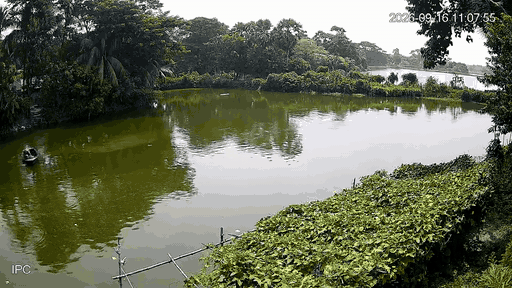
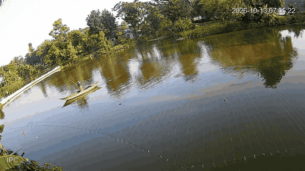
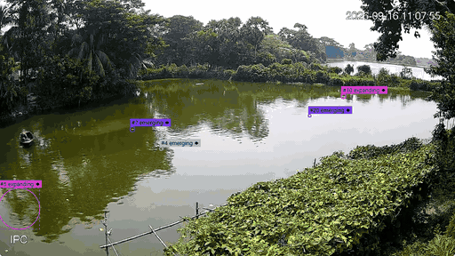
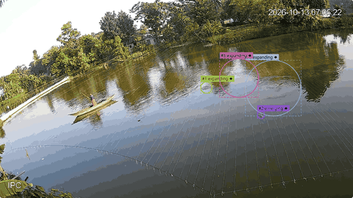
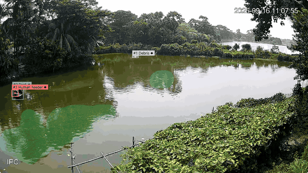
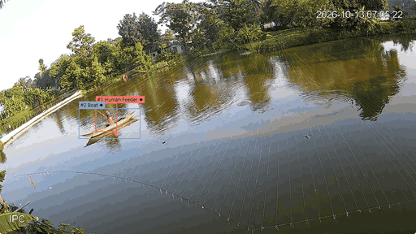
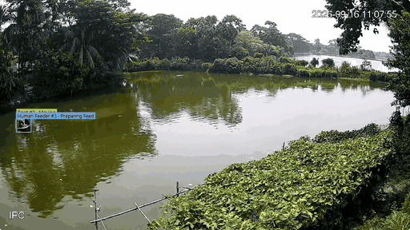
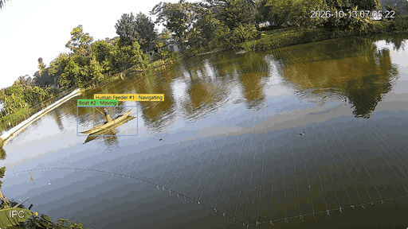

# Master Annotator

A browser-based video annotator for building aquaculture computer-vision datasets: ripples, objects, feed region, feeder/boat activity and clip metadata, annotated on pond CCTV clips and exported in YOLO format.

**[Open the annotator](https://mkbf-tech.github.io/Master-Annotator/Annotator/Annotator.html)** · [`Annotator.html` source](Annotator/Annotator.html) · [User guide](Docs/USER_GUIDE.md)

> **New here? Read the [User Guide](Docs/USER_GUIDE.md) first.** It explains every tab, control, shortcut and export file, with screenshots on the showcase clip.

It is one HTML file with no server and no upload; the videos stay on your machine. Chrome or Edge is recommended.

## Problem

Feed is the largest running cost in fish farming, and the Feed Conversion Ratio (FCR = feed given / weight gained) is the number that says how well it is used. In a pond neither side of the ratio is easy to measure. Biomass cannot be weighed continuously, and nobody can see how much of the feed was eaten and how much was wasted. FCR is therefore known only at harvest or from sparse sampling, when it is too late to change the feeding.

What can be observed every day is the feeding event itself. When fish take feed they break the surface and produce ripples, and the farm worker's activity (preparing feed, distributing it, idle) shows when and how much feed went in. Counting and sizing the ripples over time, together with the feeder's activity, gives a measurable feeding-activity signal that can be used to tune feed input and cut wastage.

## How the annotator helps

To extract that signal from video automatically, detection models must be trained, and training needs frames labelled by hand. The annotator is the tool for labelling them:

| Tab | You mark | Used for |
|---|---|---|
| Ripple Detector | ripples as circles with a stage (emerging, expanding, fading) | YOLO detection of ripples: the fish response |
| Object Detector | Human Feeder, Boat, Feed Container, Dead Fish, Live Fish, Bird, Debris; the feed region | YOLO detection of objects, YOLO-seg of the feed region |
| Activity Detector | the state of the feeder (Preparing Feed, Distributing Feed, ...) and of the boat over time | Feed input timing |
| Metadata | date, time (read by OCR), rain, lighting, period, camera, pond, feeding activity score | Joining detections to time and conditions |

Annotations are drawn on a few key frames and interpolated between them, then exported every 5th frame by default (adjustable). The export is the training set for YOLO and YOLO-seg; the trained models' predictions on new footage are what quantify feeding activity.

```
pond clips -> Master Annotator -> export (YOLO labels, MOT tracks, master.csv)
           -> train YOLO / YOLO-seg -> predictions on new video -> feeding activity per event
```

## Demo

Both clips are 5 s, 1920x1080, 25 fps, shown at reduced size. Each row is the real output of one tab on the clip.

| | Camera 1 · 2026-09-16 11:07:55 | Camera 2 · 2026-10-13 07:05:22 |
|---|---|---|
| **Raw** |  |  |
| **Ripple Detector** |  |  |
| **Object Detector** |  |  |
| **Activity Detector** |  |  |

Ripple rings are coloured per event with their stage; object boxes by class (the feed region appears as a faint overlay); activity boxes carry the feeder or boat state.

## Quick start

1. Open the [annotator](https://mkbf-tech.github.io/Master-Annotator/Annotator/Annotator.html), or open `Annotator/Annotator.html` from a clone.
2. **Load Project** and choose `Annotator/Progress File/Annotator Progress.annproj`. Both showcase clips open with their annotations.
3. Switch tabs, scrub the video, edit. **Ctrl+S** saves; **Export Data** downloads the dataset zip.

To annotate your own clips, drop videos on the start page instead. Before annotating, read the [User Guide](Docs/USER_GUIDE.md) for the workflow and shortcuts of each tab.

**Saving.** The first save asks for the `Progress File` folder (folder dialogs show no files, which is expected; just select the folder). After that, **Save Project** overwrites `Annotator Progress.annproj` there and first copies the previous version to `Backups/` (newest 5 kept). **Restore backup** opens the latest one. Browsers without folder access download the file instead.

## Dataset

`Dataset/` is the export of the two showcase clips, in the layout the annotator produces. `Raw Videos/` holds the source clips and is not part of the export zip.

```
Dataset/
├── Raw Videos/               2 source clips
├── Object/<Clip ID>/         images/, labels/ (YOLO boxes), mot.csv, data.yaml
├── YOLO-Ripple/<Clip ID>/    same, one class: ripple
├── YOLO-Feed/<Clip ID>/      images/, labels/ (YOLO-seg polygons), mot.csv, data.yaml
├── OCR/                      timestamp crops, ground-truth text, ocr.csv
├── master.csv                one row per exported frame
└── master.json               the same, per clip
```

Clip ID is `YYYY-MM-DD_HH-MM-SS_CamN_PondN`. The Cam2 clip has no feed region, so its `YOLO-Feed` folder holds only an empty `mot.csv` and `data.yaml`. Column and file details are in the [user guide](Docs/USER_GUIDE.md#8-export).

## Repository layout

```
Annotator/        Annotator.html and Progress File/ (project + Backups/)
Dataset/          export of the two showcase clips
Utilities/        ocr_timestamp.py: reads the burned-in timestamp (Python counterpart of the OCR step)
Docs/             USER_GUIDE.md, demo/ and images/
```

`ocr_timestamp.py` needs `pip install opencv-python pytesseract numpy`, the Tesseract program, and `eng.traineddata` in a `Models/Tesseract OCR/` folder at the repository root (not included).

## License

MIT, see [LICENSE](LICENSE).
